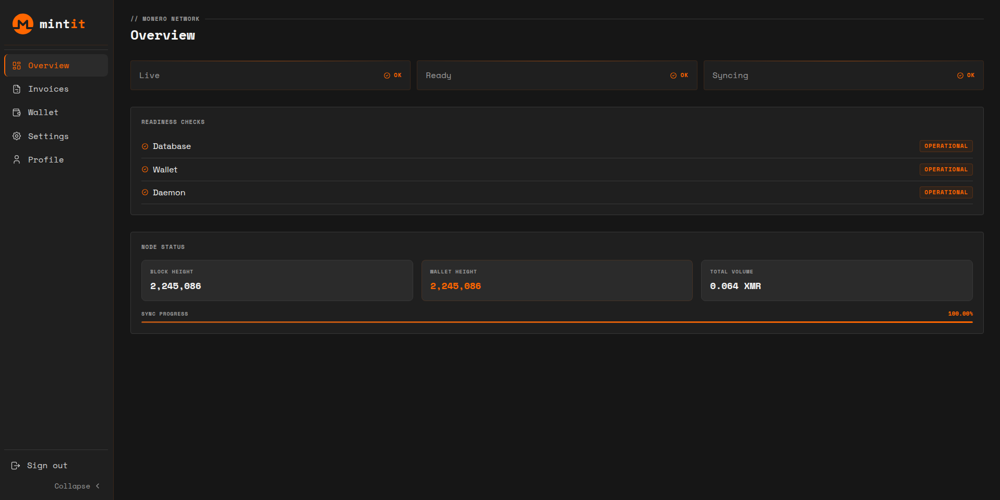

---

### A self-hosted payment processor for privacy-focused cryptocurrencies. Accepts payments in fixed fiat amounts and notifies your application via webhooks. Currently supports Monero.

## 📚 Current docs: **[mintit.dev](https://mintit.dev)**



## 🚧 Under construction: no image has been published to Docker Hub yet; build from source for evaluation using docker compose.

### Bring your own node

`docker-compose.yml` doesn't bundle `monerod` — point `MONERO_DAEMON_URI` in `.env` at a node you already run. If that node also runs in Docker, attach it to the `mint_net` network so `mint_app` can reach it by container name:

```yaml
services:
  your_node:
    networks:
      - mint_net

networks:
  mint_net:
    external: true
```

## Development

### Dev mode (hot reload)

```bash
cp .env.example.dev .env.local   # fill in RPC creds, etc.
pnpm install
pnpm dev
```

Runs the API and web app directly via `turbo run dev`, reading config from `.env.local`.

### Docker

```bash
cp .env.example.prod .env        # fill in every blank
docker compose up -d
```

All persistent state lives under `./data` (created on first start), so backing up is copying that folder:

- `data/app`: Monero wallet files and the JWT signing key. Back up the wallet; it cannot be regenerated.
- `data/caddy`: TLS certificates and the ACME account.
- `data/postgres`: the database. Stop the stack or use `pg_dump` for a consistent backup.

Builds one image from the root `Dockerfile` (multi-stage: builds `@mintit/types`, `@mintit/api`, `@mintit/web`). Nest serves everything from it: the API under `/v1`, checkout pages under `/i`, and the dashboard at every other path.

Caddy (`mint_proxy`, configured by `docker/Caddyfile`) terminates TLS on ports 80/443 using `DOMAIN` and `ACME_EMAIL`. To use your own web server instead, delete the `mint_proxy` service from `docker-compose.yml` and replace `mint_app`'s `expose` with `ports: ['127.0.0.1:3000:3000']`, which makes the API reachable from the host but not the internet. Forward all traffic to `127.0.0.1:3000` and set `X-Forwarded-For` and `X-Forwarded-Proto`: the API trusts one proxy hop for client IPs (rate limiting) and the session cookie's `Secure` flag. For nginx:

```nginx
location / {
    proxy_pass http://127.0.0.1:3000;
    proxy_set_header Host $host;
    proxy_set_header X-Forwarded-For $remote_addr;
    proxy_set_header X-Forwarded-Proto $scheme;
}
```

See `docker-compose.yml` for the full service layout.
