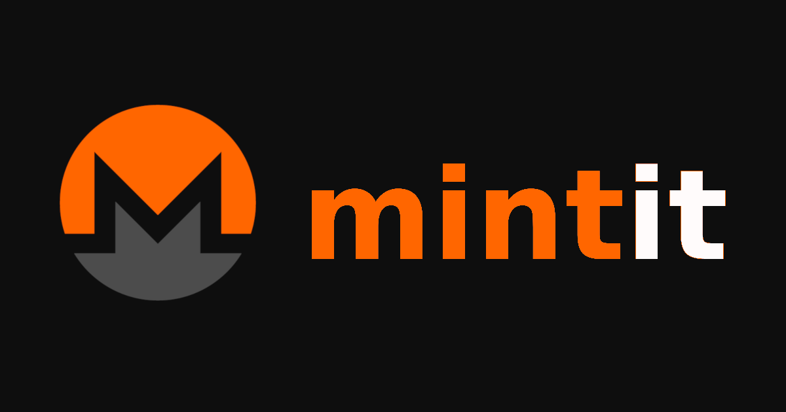
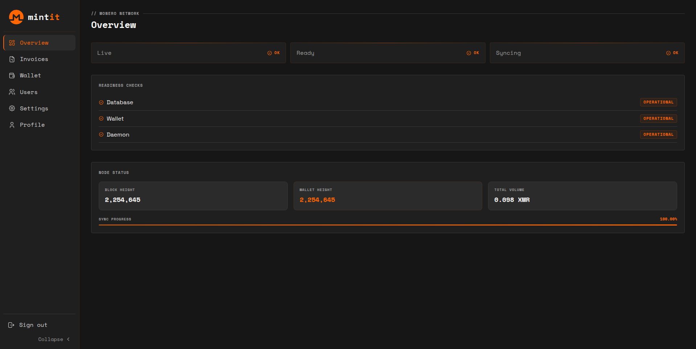

---

### A self-hosted payment processor for privacy-focused cryptocurrencies. Accepts payments in fixed fiat amounts and notifies your application via webhooks or invoice page. Currently supports Monero.

## 📚 Current docs: **[mintit.dev](https://mintit.dev)**

## 🧪 Live demo (stagenet): **[demo.mintit.dev](https://demo.mintit.dev)**

Log in with `admin@mintit.dev` / `password`, TOTP `123456`. It's a shared account on stagenet, so the coins have no value and other visitors can see what you create.



## 🚧 Beta: [`nexusocean/mintit-app`](https://hub.docker.com/r/nexusocean/mintit-app) is published as `0.1.0-beta.1` for evaluation.

### Bring your own node

mintit doesn't bundle `monerod`: point `MONERO_DAEMON_URI` in `.env` at a node you already run. Its RPC port is `18081` on mainnet and `38081` on stagenet (match `MONERO_NETWORK`).

If you don't run a node yet, [simple-monerod-docker](https://github.com/sethforprivacy/simple-monerod-docker) is a commonly used third-party image. Pin a release tag rather than `latest`, so the node doesn't change underneath a running payment processor.

The Docker setups below expect the node on an external Docker network named `monero-net`, so `mint-app` can reach it by container name (e.g. `MONERO_DAEMON_URI=http://monerod:18081`). Create it once with `docker network create monero-net` and attach your node:

```yaml
services:
  monerod:
    networks:
      - monero-net

networks:
  monero-net:
    external: true
```

If the node isn't in Docker, remove `monero-net` from the setup's `docker-compose.yml` and point `MONERO_DAEMON_URI` at the node's address instead.

## Development

### Dev mode (hot reload)

```bash
cp .env.example.dev .env.local   # fill in RPC creds, etc.
pnpm install
pnpm dev
```

Runs the API and web app directly via `turbo run dev`, reading config from `.env.local`.

### Docker

```bash
cd docker
cp .env.example .env             # fill in every blank
docker compose up -d
```

Pulls the published image and runs it next to Postgres. The image is built from `docker/Dockerfile` (multi-stage: builds `@mintit/types`, `@mintit/api`, `@mintit/web`). Nest serves everything from it: the API under `/v1`, checkout pages under `/i`, and the dashboard at every other path. The app listens on `127.0.0.1:3000` only, for a web server on the same host.

Release images are signed with cosign, keyless from GitHub Actions. To verify one before running it:

```bash
cosign verify docker.io/nexusocean/mintit-app:0.1.0-beta.1 \
  --certificate-identity-regexp '^https://github.com/NexusOcean/mintit/\.github/workflows/release\.yml@refs/tags/v' \
  --certificate-oidc-issuer https://token.actions.githubusercontent.com
```

All persistent state lives in `docker/data` (created on first start), so backing up is copying that folder:

- `data/app`: Monero wallet files, the JWT signing key, and `jwt/totp-key`, which encrypts the admin's 2FA secret and backup codes. Back up the wallet and `totp-key`: neither can be regenerated, and without `totp-key` the admin cannot sign in with 2FA.
- `data/postgres`: the database. Stop the stack or use `pg_dump` for a consistent backup.

### Web server

Put a web server in front to terminate TLS, e.g. nginx with a certificate from certbot. Forward everything to the app and pass the client details through: the app trusts one proxy hop for client IPs (rate limiting) and the session cookie's `Secure` flag.

```nginx
location / {
    proxy_pass http://127.0.0.1:3000;
    proxy_set_header Host $host;
    proxy_set_header X-Forwarded-For $remote_addr;
    proxy_set_header X-Forwarded-Proto $scheme;
}
```
